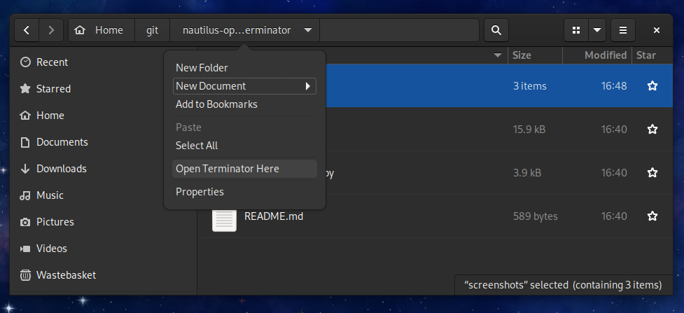
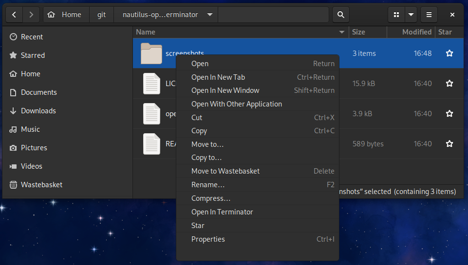

# open-terminator.py

Add `Open In Terminator` and `Open Terminator Here` to the right-click menu in Nautilus / GNOME Files.

## Dependencies

Ensure you have the Nautilus Python bindings and `terminator` installed:

  - Fedora and derivatives:

        sudo dnf install nautilus-python terminator

  - Debian / Ubuntu and derivatives:

        sudo apt-get install python3-nautilus terminator

  - Arch Linux:

        sudo pacman -S nautilus-python terminator

## Install

Download a `.deb`, `.rpm`, or Arch `.pkg.tar.*` package from the [GitHub Releases](https://github.com/timhughes/nautilus-open-terminator/releases) page, or build and install from source:

Install for your user account (with translations):

    git clone https://github.com/timhughes/nautilus-open-terminator.git
    cd nautilus-open-terminator
    make install-user

Install system-wide (with translations):

    git clone https://github.com/timhughes/nautilus-open-terminator.git
    cd nautilus-open-terminator
    sudo make install

Build local distro packages (`.deb`, `.rpm`, Arch, or source tarball into `dist/`):

    make deb    # Debian/Ubuntu
    make rpm    # Fedora/RHEL
    make arch   # Arch Linux
    make dist   # Source tarball

Quick single-file install (English only):

    mkdir -p ${HOME}/.local/share/nautilus-python/extensions/
    curl -Lo ${HOME}/.local/share/nautilus-python/extensions/open-terminator.py https://raw.githubusercontent.com/timhughes/nautilus-open-terminator/master/src/open-terminator.py

You may need to restart Nautilus to load the extension:

    pkill nautilus

*(If switching from the single-file `curl` user install to a distro package or `sudo make install`, remove `~/.local/share/nautilus-python/extensions/open-terminator.py` first to avoid duplicate menu entries.)*

## Testing

Run the unit tests, syntax check, and AppStream metadata validation:

    make check

## Translations

Translations are managed with `gettext` in the `po/` directory. To add a new language (e.g. `sv`):

    msginit -i po/nautilus-open-terminator.pot -o po/sv.po -l sv
    # Edit po/sv.po, then test building:
    make && make check

To test a translation live in Nautilus (e.g. French `fr`):

    nautilus -q; LANGUAGE=fr nautilus --no-desktop &

Run `nautilus -q` afterward to return Nautilus to your default language.

## Screenshots

